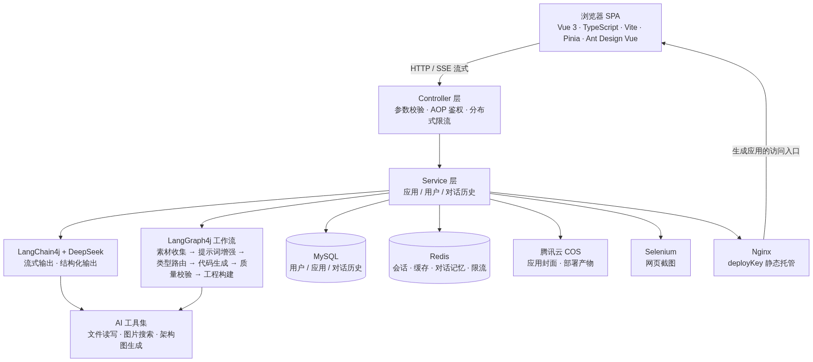

# ai-app-studio · AI 应用生成平台

用一句自然语言描述需求，AI 自动生成一个可访问的 Web 应用。

从「想要一个什么样的页面」到「拿到一个能打开的网址」，全程对话完成，无需写一行代码。

---

## 核心功能

- **三种生成模式，AI 自动选择** —— 根据需求描述智能判断输出 HTML 单页、多文件项目还是完整的 Vue 工程，用户无需关心技术细节
- **全过程流式可见** —— 通过 SSE 实时推送生成过程，包括 AI 每一次文件读写的工具调用，而不是只给一个转圈
- **对话式增量修改** —— 在已生成的应用上继续提需求，AI 通过工具调用精准修改文件，而不是把整个项目重写一遍
- **一键部署上线** —— Vue 工程自动构建、产物推送到 Nginx，并自动截图生成应用封面
- **AI 工作流编排** —— 用 LangGraph4j 把「素材收集 → 提示词增强 → 类型路由 → 代码生成 → 质量校验 → 工程构建」串成可编排的状态图

## 技术栈

| 层次 | 技术选型 |
|---|---|
| 后端 | Java 21 · Spring Boot 3.5 · MyBatis-Flex · AOP |
| AI 能力 | LangChain4j 1.1 · LangGraph4j · DeepSeek / Qwen |
| 数据与缓存 | MySQL · Redis（会话 / 缓存 / 对话记忆 / 限流） |
| 分布式 | Redisson 令牌桶限流 · Spring Session + Redis 多实例会话共享 |
| 其他 | Selenium（网页截图） · 腾讯云 COS · SSE（流式输出） |
| 前端 | Vue 3 · TypeScript · Vite · Pinia · Ant Design Vue |

## 系统架构



## 关键设计

### 1. 生成类型交给 AI 路由，而不是让用户选

创建应用时只有一段提示词，由 `AiCodeGenTypeRoutingService` 通过**结构化输出**直接返回枚举值来决定走哪条生成链路。
路由使用独立构建的轻量模型（qwen-turbo，不带 JSON Schema 约束），避免与主模型的结构化输出配置互相干扰；调用失败时降级到 DeepSeek，保证「创建应用」这个核心动作不会因路由异常而失败。

### 2. 流式输出为什么是 `TokenStream` 而不是 `Flux<String>`

用 `Flux<String>` 时，LangChain4j 只会转发 AI 的**文本增量**，工具调用事件（工具名、文件路径、写入内容）会全部丢失，前端就看不到任何写文件过程。
改用 `TokenStream` 并监听 `onToolExecuted`，才能拿到完整的工具调用参数，把「AI 正在写哪个文件」实时透传给前端。

### 3. AI 工作流用状态图编排

把生成流程拆成独立节点，节点间通过统一的状态对象传递数据；支持条件边（HTML 跳过工程构建）、循环边（质检不通过自动返工重生成，最多 N 轮）以及并发分支（多类图片素材并行收集）。
节点依赖全部走构造器注入，因此**不启动 Spring 容器就能对单节点和整张图做单元测试**。

### 4. 多实例下的会话与限流

- 登录态存 Redis（Spring Session），服务多实例部署时不会因为换了一台机器就掉登录
- 接口限流用 Redisson 令牌桶，配置化阈值 + `@RateLimit` 注解 + AOP 切面，支持按 IP / 用户维度

### 5. 安全基线

- 密码使用 **BCrypt**（随机盐 + 可调计算成本），不使用 MD5 等快速哈希
- 列表查询的排序字段走**显式白名单**校验，杜绝 `ORDER BY` 拼接注入
- 用户输入经 Prompt 护轨审查（长度限制 + 敏感词），防提示词注入

## 快速开始

### 环境要求

- JDK 21
- MySQL 8（建库后执行 `ai-app-studio-backend/sql/create_table.sql`）
- Redis
- Node 20+（前端）

### 1. 配置后端

```bash
cd ai-app-studio-backend
cp src/main/resources/application-local.example.yml src/main/resources/application-local.yml
```

然后编辑 `application-local.yml`，填入自己的 **DeepSeek API Key**（必填）以及可选的阿里云百炼、腾讯云 COS 配置。

> 该文件已在 `.gitignore` 中，不会被提交。

### 2. 启动后端

```bash
mvn spring-boot:run
```

接口文档：<http://localhost:8123/api/doc.html>

### 3. 启动前端

```bash
cd ../ai-app-studio-frontend
npm install
npm run dev
```

## 项目结构

```
.
├── ai-app-studio-backend/            # Spring Boot 后端
│   ├── src/main/java/com/haoy/aiapp/
│   │   ├── ai/                        # AI 服务接口、工具集、Prompt 护轨
│   │   ├── langgraph4j/               # AI 工作流（状态 / 节点 / 图）
│   │   ├── core/                      # 代码生成、解析、落盘、流式处理
│   │   ├── controller/                # 接口层
│   │   ├── service/                   # 业务层
│   │   ├── ratelimit/                 # 分布式限流
│   │   └── utils/                     # 工具类
│   ├── src/main/resources/
│   │   ├── prompt/                    # 提示词模板（生成质量的主要开关）
│   │   └── application*.yml
│   └── sql/create_table.sql
└── ai-app-studio-frontend/           # Vue 3 前端
    └── src/
        ├── pages/                     # 页面
        ├── components/                # 组件
        ├── api/                       # 接口封装（由 OpenAPI 自动生成）
        └── stores/                    # Pinia 状态
```

## 说明

- 后端 `application.yml` 中的 MySQL / Redis 连接为本地默认值，部署时请自行覆盖
- **AI 生成的代码**输出到 `ai-app-studio-backend/tmp/code_output/`（开发中间产物，已在 `.gitignore` 中忽略）
- **应用部署产物**输出到 `app.deploy.root-dir`（默认 `E:/ai-app-studio-data/deploy`，在项目目录之外）。
  ⚠️ 它必须与 Nginx 配置里的 `root` **完全一致**，否则访问部署地址会 404 ——
  放在项目外正是为了让项目目录改名/移动时不影响部署。可用环境变量 `APP_DEPLOY_ROOT_DIR` 覆盖。
- **本地必须先起 Nginx**，否则「部署」看起来成功、实际打不开，封面截图也会失败：

  ```bat
  cd /d D:\nginx\nginx-1.30.5
  nginx.exe
  ```

  Nginx 监听 `8080`（`app.deploy.host` 默认 `http://localhost:8080`），`root` 指向上面的部署目录。
  ⚠️ **一定要先 `cd` 到 Nginx 目录再执行**（或用 `nginx.exe -p <dir> -c conf/nginx.conf`）——
  Windows 版 Nginx 是按**当前工作目录**去找 `conf/` 的，在项目目录里直接调用会报
  `CreateFile() ".../ai-app-studio/conf/nginx.conf" failed`。
  停止用 `nginx.exe -s stop`；改完配置先 `nginx.exe -t` 验语法。
- 前端接口类型通过 `npm run openapi2ts` 从后端 Swagger 文档自动生成，保持前后端契约一致
