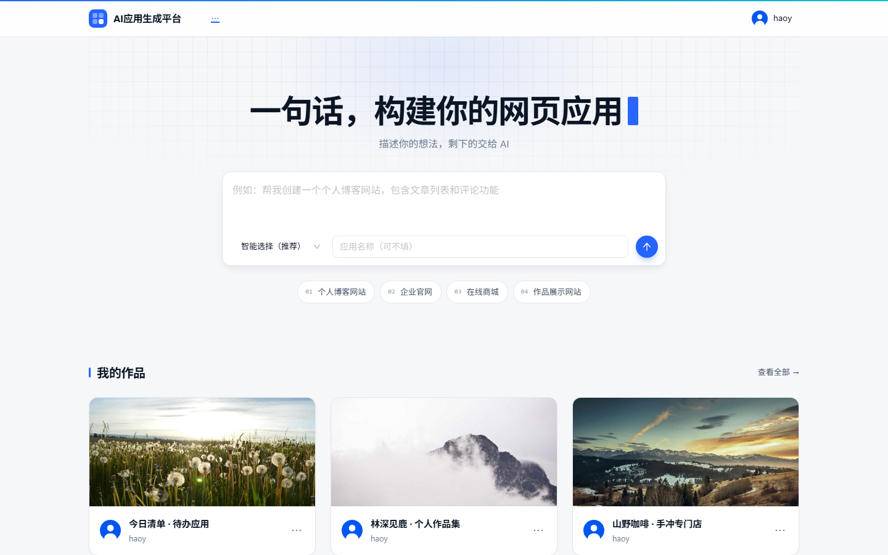
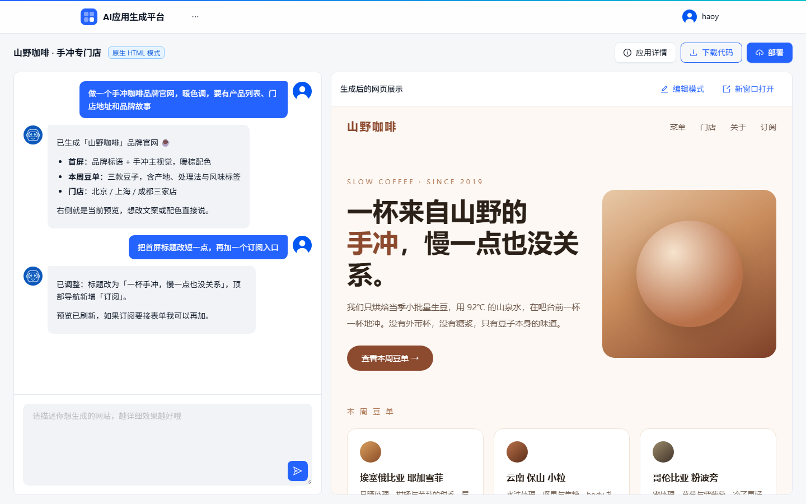
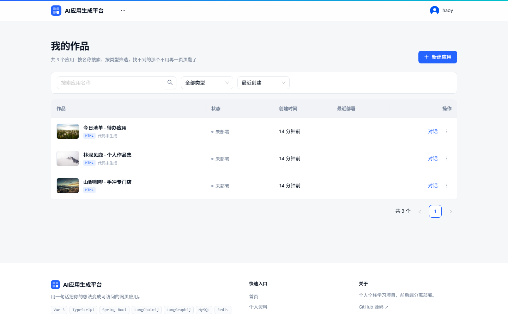
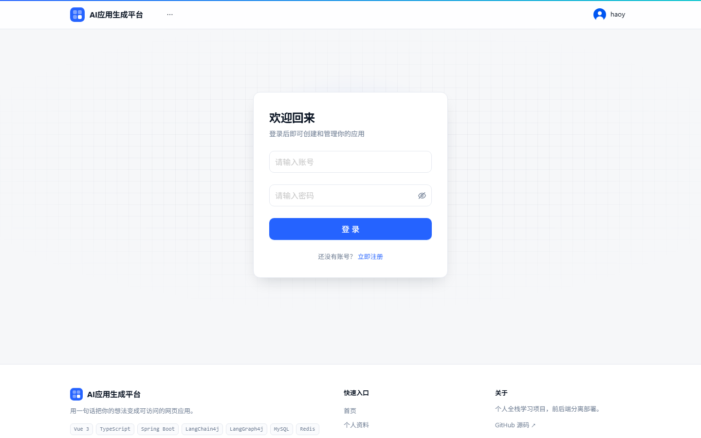

<div align="center">

# ai-app-studio · AI 应用生成平台

**用一句自然语言描述需求，AI 自动生成一个可访问的 Web 应用。**

从「想要一个什么样的页面」到「拿到一个能打开的网址」，全程对话完成。

[](https://github.com/haoy-ang/ai-app-studio/actions/workflows/ci.yml)


</div>

---

## 目录

- [核心功能](#核心功能)
- [技术栈](#技术栈)
- [系统架构](#系统架构)
- [关键设计](#关键设计)
- [快速开始](#快速开始)
- [项目结构](#项目结构)
- [质量与测试](#质量与测试)
- [已知限制](#已知限制)

## 核心功能

- **三种生成模式，AI 自动选择** —— 根据需求描述判断输出 HTML 单页、多文件项目还是完整的 Vue 工程，用户不需要懂技术细节
- **全过程流式可见** —— SSE 实时推送生成过程，包括 AI 每一次文件读写的工具调用，而不是只有一个转圈
- **对话式增量修改** —— 在已生成的应用上继续提需求，AI 通过工具调用精准改文件，而不是把整个项目重写一遍
- **可视化编辑** —— 直接在预览 iframe 里点选元素，把「改这个按钮的颜色」翻译成给 AI 的上下文
- **一键部署上线** —— Vue 工程自动构建、产物推送到 Nginx，并自动截图生成应用封面
- **版本快照与一键回滚** —— 每次生成打一个快照，可回滚到任意历史版本，回滚不丢 `node_modules`
- **AI 工作流编排** —— 用 LangGraph4j 把「素材收集 → 提示词增强 → 类型路由 → 代码生成 → 质量校验 → 工程构建」串成可编排的状态图

## 界面预览

| 首页：一句话创建应用 | 对话生成 + 实时预览 |
|---|---|
|  |  |

| 我的作品：搜索 / 筛选 / 排序 / 版本 | 登录 |
|---|---|
|  |  |

## 技术栈

| 层次 | 技术选型 |
|---|---|
| 后端 | Java 21 · Spring Boot 3.5 · MyBatis-Flex · AOP |
| AI 能力 | LangChain4j 1.1 · LangGraph4j · DeepSeek / Qwen |
| 数据与缓存 | MySQL · Redis（会话 / 缓存 / 对话记忆 / 限流） |
| 分布式 | Redisson 令牌桶限流 · Spring Session + Redis 多实例会话共享 |
| 其他 | Selenium（网页截图） · 腾讯云 COS · SSE（流式输出） |
| 前端 | Vue 3 · TypeScript · Vite · Pinia · Ant Design Vue |
| 工程化 | GitHub Actions · JaCoCo · Docker Compose · ESLint |

## 系统架构


## 关键设计

### 1. 生成类型交给 AI 路由，而不是让用户选

创建应用时只有一段提示词，由 `AiCodeGenTypeRoutingService` 通过**结构化输出**直接返回枚举值来决定走哪条生成链路。
路由使用独立构建的轻量模型（qwen-turbo，不带 JSON Schema 约束），避免与主模型的结构化输出配置互相干扰；调用失败时降级到 DeepSeek，保证「创建应用」这个核心动作不会因路由异常而失败。

### 2. 流式输出为什么是 `TokenStream` 而不是 `Flux<String>`

用 `Flux<String>` 时，LangChain4j 只会转发 AI 的**文本增量**，工具调用事件（工具名、文件路径、写入内容）会全部丢失，前端就看不到任何写文件过程。
改用 `TokenStream` 并监听 `onToolExecuted`，才能拿到完整的工具调用参数，把「AI 正在写哪个文件」实时透传给前端。

> 同一类问题在 SSE 层还有一次：工作流吐出的字符串本身已经是成型的 SSE 文本，直接走 `Flux<String>` 会被 Spring 再包一层 `data:`，事件名被塞进 data 里，浏览器永远收不到。这里改成了 `StreamingResponseBody` 原样写字节。

### 3. AI 工作流用状态图编排

把生成流程拆成六个节点，节点间通过统一的状态对象传递数据；支持**条件边**（HTML 跳过工程构建）、**循环边**（质检不通过自动返工重生成，带最大次数刹车）以及**并发分支**（多类图片素材并行收集）。
节点依赖全部走构造器注入，因此**不启动 Spring 容器就能对单节点和整张图做单元测试**。

### 4. 多实例下的会话与限流

- 登录态存 Redis（Spring Session），服务多实例部署时不会因为换了一台机器就掉登录
- 接口限流用 Redisson 令牌桶，配置化阈值 + `@RateLimit` 注解 + AOP 切面，支持按 IP / 用户维度

### 5. 安全基线

- 密码使用 **BCrypt**（随机盐 + 可调计算成本），不使用 MD5 等快速哈希；老 MD5 数据仍可登录
- 列表查询的排序字段走**显式白名单**校验，杜绝 `ORDER BY` 拼接注入
- AI 文件工具的路径经 `normalize + startsWith` 校验，绝对路径与 `../` 穿越一律拒绝
- 用户输入经 Prompt 护轨审查（长度限制 + 敏感词），流式与非流式路径都能把拦截原因翻译成人话
- 删除应用/用户都做了级联清理（对话、封面、部署目录、版本、账号释放），不留孤儿数据

## 快速开始

### 方式一：Docker Compose（推荐）

需要：Docker Desktop / Docker Engine（含 Compose v2）。

```bash
cp .env.example .env
# 打开 .env，填入 DEEPSEEK_API_KEY（必填），其余可选
docker compose up -d --build
```

| 入口 | 地址 |
|---|---|
| 前端 | <http://localhost:8088> |
| 后端接口 | <http://localhost:8123/api> |
| 接口文档 | <http://localhost:8123/api/doc.html> |

- 首次启动会自动建库建表（`ai-app-studio-backend/sql/create_table.sql`）
- MySQL / Redis 不对宿主机暴露端口，需要连库用 `docker compose exec mysql mysql -uroot -p`
- **部署功能不在 compose 里**：它要把产物交给一个长期存在的 Nginx 目录，且截图需要容器能访问到，所以仍走宿主机 Nginx（见下文「部署」）

### 方式二：本地开发

环境要求：JDK 21、Maven 3.9+、MySQL 8、Redis、Node 20+。

#### 1. 配置后端

```bash
cd ai-app-studio-backend
cp src/main/resources/application-local.example.yml src/main/resources/application-local.yml
```

编辑 `application-local.yml`，填入自己的 **DeepSeek API Key**（必填）以及可选的阿里云百炼、腾讯云 COS 配置。
该文件已在 `.gitignore` 中，不会被提交。

#### 2. 建库

```bash
mysql -uroot -p < sql/create_table.sql
```

#### 3. 启动后端

```bash
mvn spring-boot:run
```

接口文档：<http://localhost:8123/api/doc.html>

#### 4. 启动前端

```bash
cd ../ai-app-studio-frontend
npm install
npm run dev
```

访问 <http://localhost:5173>，`/api` 由 Vite 代理到 `8123`。

#### 5. 部署（可选）

部署需要先起宿主机 Nginx：

```bat
cd /d D:\nginx\nginx-1.30.5
nginx.exe
```

- Nginx 监听 **8080**（`app.deploy.host` 默认 `http://localhost:8080`）
- `root` 必须与 `app.deploy.root-dir`（默认 `E:/ai-app-studio-data/deploy`）**完全一致**，否则部署地址 404
- Windows 版 Nginx 按**当前工作目录**找 `conf/`，一定要先 `cd` 到 Nginx 目录再执行
- 停止用 `nginx.exe -s stop`；改完配置先 `nginx.exe -t` 验语法

> 部署目录和版本快照目录都固定在项目之外，项目改名/移动不会让线上地址和已有版本失效。

### 常用命令

| 位置 | 命令 | 说明 |
|---|---|---|
| 后端 | `mvn test` | 只跑确定性测试（秒级、免费） |
| 后端 | `mvn test -Dtest.groups=requires-ai` | 只跑真实调用大模型的用例（花钱，慢） |
| 后端 | `mvn test -Dtest.excluded.groups=requires-browser` | 跳过需要真浏览器的截图用例 |
| 前端 | `npm run dev` / `npm run build` | 开发 / 类型检查 + 构建 |
| 前端 | `npm run type-check` / `npm run lint` | 类型检查 / ESLint |
| 前端 | `npm run openapi2ts` | 依据后端 OpenAPI 重新生成 `src/api` |

## 项目结构

```
.
├── ai-app-studio-backend/            # Spring Boot 后端
│   ├── src/main/java/com/haoy/aiapp/
│   │   ├── ai/                        # AI 服务接口、工具集、Prompt 护轨
│   │   ├── langgraph4j/               # AI 工作流（状态 / 节点 / 图）
│   │   ├── core/                      # 代码生成、解析、落盘、流式处理
│   │   ├── eval/                      # 产物静态检查与端到端评估
│   │   ├── controller/                # 接口层
│   │   ├── service/                   # 业务层
│   │   ├── ratelimit/                 # 分布式限流
│   │   └── version/                   # 版本快照存储
│   ├── src/main/resources/
│   │   ├── prompt/                    # 提示词模板（生成质量的主要开关）
│   │   └── application*.yml
│   └── sql/                           # 建表 / 升级脚本
├── ai-app-studio-frontend/           # Vue 3 前端
│   └── src/
│       ├── pages/                     # 页面
│       ├── components/                # 组件
│       ├── composables/               # 可复用逻辑（SSE / 历史 / 应用操作）
│       ├── api/                       # 接口封装（由 OpenAPI 自动生成）
│       └── stores/                    # Pinia 状态
├── .github/workflows/ci.yml          # CI：后端测试 + 前端检查
├── docker-compose.yml                # 一键启动
├── docs/screenshots/                 # README 用的界面截图
└── architecture.png
```

## 质量与测试

| 指标 | 现状 |
|---|---|
| 后端用例 | **176 个**（CI 跑 173 个：再排除需要真实浏览器与真实大模型的用例），JaCoCo 指令覆盖率 **63.2%** |
| 测试分档 | `requires-ai`（真实调模型）与 `requires-browser`（真浏览器）都被单独隔离，`mvn test` 默认秒级、免费 |
| 前端 | `vue-tsc` 类型检查 + ESLint + 生产构建，CI 全绿 |
| CI | 每次 push / PR 自动跑：MySQL + Redis 服务容器、建表、后端测试、前端类型检查、Lint、构建 |

另外有一套**产物静态检查器**（L0/L1）：检查 AI 生成的页面有没有占位符残留、外链死链、Vue 工程能否通过结构校验；L2 端到端评估会真的跑生成并和基线做 diff，因为耗时耗钱，不在默认测试档里。

## 已知限制

- **部署依赖宿主机 Nginx**，容器版只负责生成 / 预览 / 版本管理
- **Docker Compose 没有进 CI**（CI 只验证构建与测试），首次 `up` 如遇镜像拉取或端口冲突，按日志调整即可
- **前端暂无单元测试**，靠类型检查 + ESLint + 构建兜底
- 对话历史的游标分页以 `id` 为准；更早的实现用秒级 `createTime`，同秒消息会漏翻页（已修）
- 应用创建时路由一次生成类型后写死，中途换需求不会重新判定
- 本地默认关闭限流（所有请求都来自 127.0.0.1，会自己把自己限死），上线前应打开

## License

[MIT](LICENSE) © haoy
